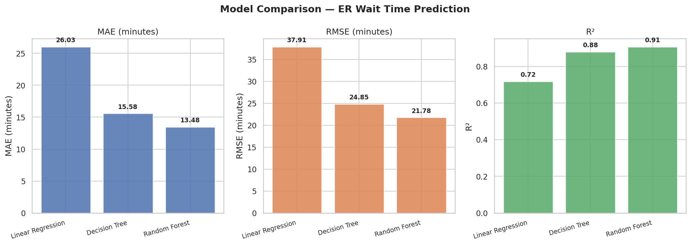
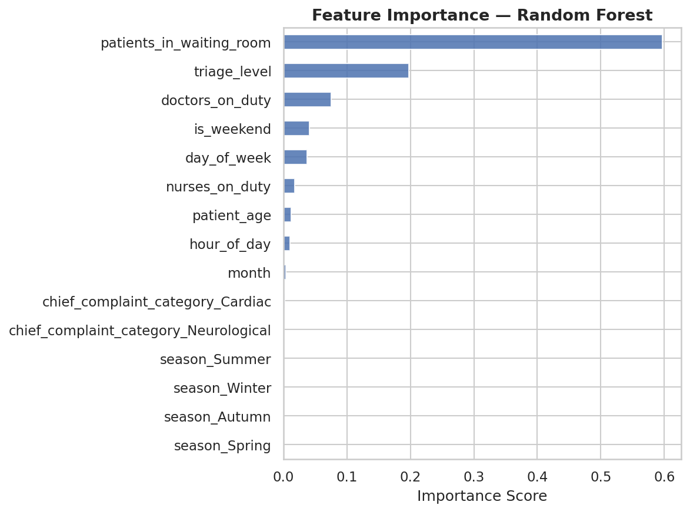
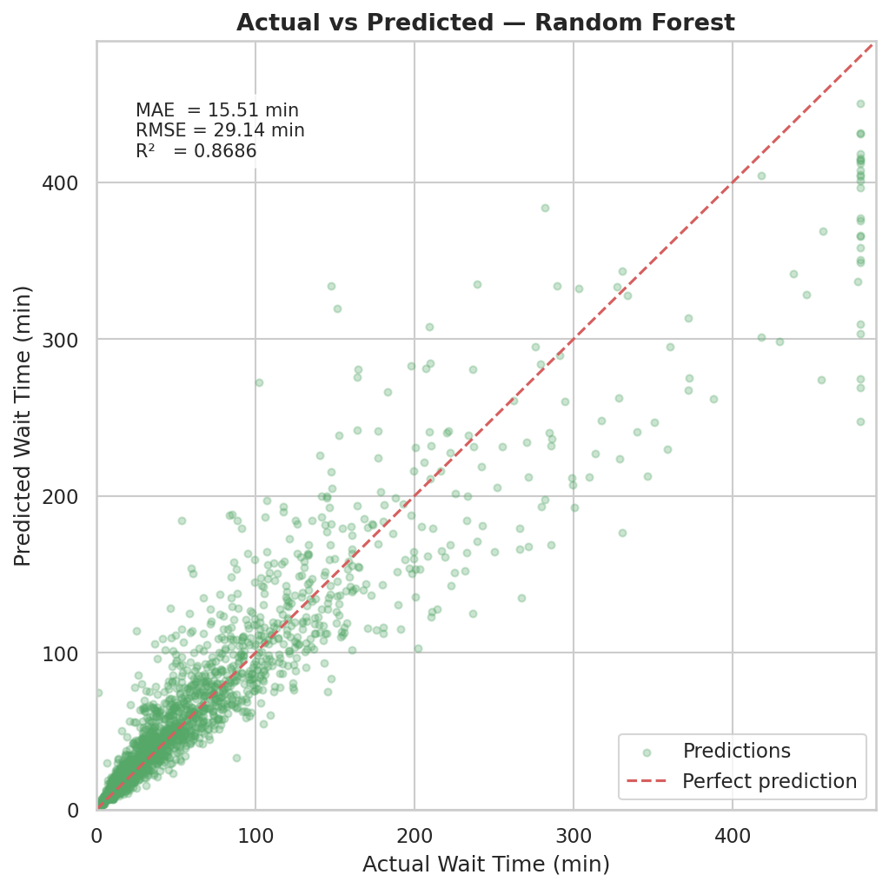
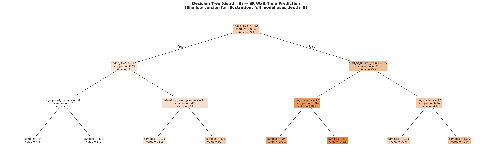

# ER Wait Time Predictor

A machine learning proof of concept that predicts **how many minutes a patient will wait** in a hospital emergency room, using only information available at check-in: arrival time, triage level, type of complaint, patient age, and how many patients and staff are in the ER.

A **Streamlit web app** lets reception staff enter the patient's data and get an instant prediction, colour-coded by expected wait (under 30 minutes, 30 to 60 minutes, over 60 minutes).

Built by a team of 3 for the Artificial Intelligence course (L.EIC, FEUP, 2025/26), Assignment 2: a machine learning consulting proof of concept framed around the emergency department of a hospital in Porto. Grade: **18.6/20**.

## How it works

1. **Synthetic data**: 10,000 ER visits generated with a queueing model (M/M/c), with realistic patterns such as longer waits at weekends, at peak hours, in winter and for lower triage priorities ([generate_data.py](data/generate_data.py))
2. **Feature engineering**: staff-to-patient ratio, an age priority score for children and the elderly, and circular encodings of hour and month ([train_models.py](model/train_models.py))
3. **Models**: Linear Regression (baseline), Decision Tree and Random Forest, compared with 5-fold cross-validation and an 80/20 train/test split
4. **App**: the best model is saved and served in the Streamlit app ([app.py](app/app.py))

## Results

| Model | Test MAE | R² | Improvement over the naive baseline |
|---|---|---|---|
| Naive baseline (mean) | 28.30 min | | |
| Linear Regression | 15.61 min | 0.66 | 44.8% |
| Decision Tree | 13.57 min | 0.69 | 52.0% |
| **Random Forest** | **11.75 min** | **0.77** | **58.5%** |

The Random Forest predicts the wait time with an average error of about 12 minutes and is the model used by the app.

| Model comparison | Feature importance |
|---|---|
|  |  |

| Actual vs predicted | Decision tree |
|---|---|
|  |  |

## Tech stack

Python, pandas, NumPy, SciPy, scikit-learn, matplotlib, seaborn, joblib, Streamlit

## Running locally

```bash
python -m venv venv
source venv/bin/activate          # Windows: venv\Scripts\activate
pip install -r requirements.txt

python data/generate_data.py      # generate the synthetic dataset
python model/train_models.py      # train and compare the models
streamlit run app/app.py          # open the web app
```

## Documentation

- [Presentation](presentation/Assignment2_Presentation.pdf)
- [Full course report](docs/COURSE_REPORT.md): feature set, data validation and development steps

## My contribution

Data analysis, the presentation and the report.

## Team

António Miller, Guilherme Linhares, José Reis
